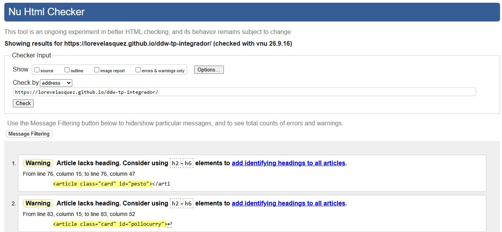
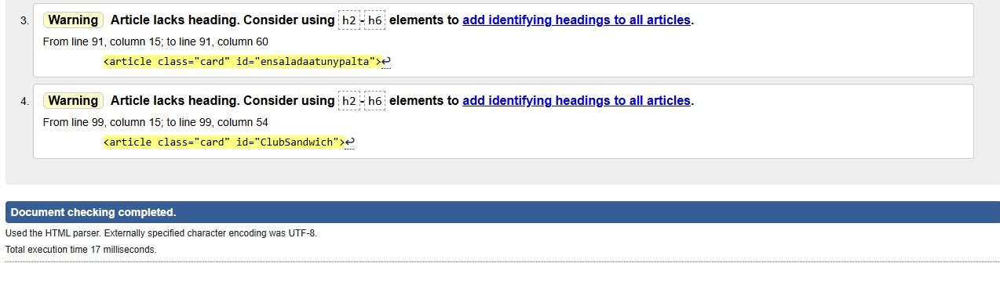
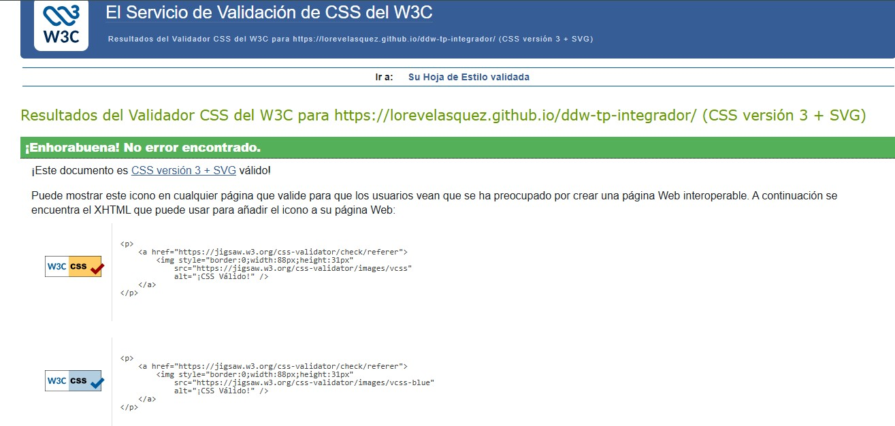

# Sitio de Recetas
## Cocina y Sabor

Trabajo Práctico Integrador · Diseño y Desarrollo Web · UADE

Sitio desarrollado con HTML5, CSS3 y Flexbox, con JavaScript para la generación dinámica del contenido y las interacciones (ver [Entrega 2](#entrega-2--javascript) más abajo). Presenta recetas caseras variadas, con navegación por anclas y diseño responsive para escritorio y tablet.

**Sitio publicado**: https://lorevelasquez.github.io/ddw-tp-integrador/

---

## Secciones del sitio

- **Inicio** — header con logo y menú de navegación, seguido de un hero con imagen de fondo y presentación del sitio.
- **Nosotros** — texto sobre la propuesta de Cocina y Sabor.
- **Recetas** — generadas dinámicamente desde un array de JavaScript, en cards con link a la receta completa. Cada una se puede marcar como favorita, y hay un filtro para ver solo las marcadas.
- **Galería** — fotos de utensilios e ingredientes, también generadas desde un array de JavaScript.
- **Contacto** — dentro del footer, con datos de contacto y redes sociales.

## Tecnologías utilizadas
- HTML5 semántico
- CSS3 con Flexbox
- JavaScript (sin frameworks ni librerías)
- localStorage para persistir los favoritos
- Google Fonts

## Entrega 2 — JavaScript

Sobre la base de la Entrega 1, se incorporó:

- **Arrays de datos**: las recetas y las fotos de la galería viven en arrays de objetos en `js/main.js`, no están escritas a mano en el HTML.
- **Generación dinámica del DOM**: ambas secciones (recetas y galería) se arman con `createElement`/`appendChild` a partir de esos arrays.
- **Favoritos**: un botón (★/☆) en cada card de receta para marcarla como favorita. El estado se guarda en `localStorage`, así que persiste entre visitas.
- **Filtro**: un botón para ver solo las recetas marcadas como favoritas, o volver a verlas todas.

Más detalle de cómo probar esto en [`README.txt`](./README.txt).

## Integrantes
Ver detalle completo en [`integrantes.txt`](./integrantes.txt).

- Giménez Balestra, Leonardo Gabriel - Comisión: Viernes Noche - leogimenez@uade.edu.ar
- Romano, Lautaro Marcos - Comisión: Viernes Noche - laromano@uade.edu.ar
- Velasquez, Lorena Isabel - Comisión: Viernes Noche - lvelasquez@uade.edu.ar

## Navegadores probados
- Google Chrome
- Microsoft Edge
- Mozilla Firefox

## Horas aproximadas

- **Estructura HTML y contenido**: ~6 horas
- **Diseño y estilos CSS**: ~7 horas
- **Integración de ramas y uso de GitHub**: ~5 horas

**Total aproximado**: ~18 horas (repartidas entre los 3 integrantes)

## Validación W3C
- **HTML**: 0 errores (quedan 4 warnings menores de tipo "article lacks heading", no bloqueantes)

- **CSS**: 0 errores, CSS3 válido
